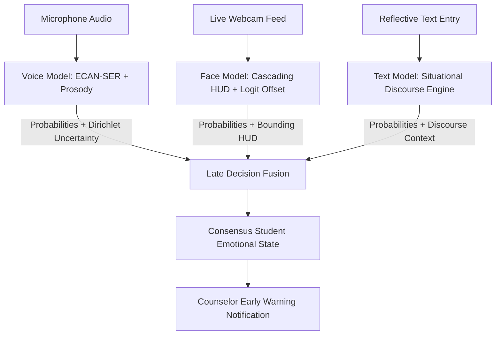

# Multimodal AI Emotional Wellbeing Monitoring System for Students

This project is a multimodal system designed to analyze student emotional states across audio, visual, and textual inputs to help school counselors and teachers identify students experiencing prolonged distress or anxiety.

## Overview

Student wellbeing often doesn't show up in just one place. A student might sound tired or stressed in their voice, look distressed on video, or write in a withdrawn tone. To handle this, we are building three separate emotion recognition models that will be combined using late fusion:

1. **Voice (Speech Emotion Recognition)**: Analyzes tone, pitch, energy, and speech acoustics. Located in `voice_model/`.
2. **Face (Facial Emotion Recognition)**: Analyzes facial cues and micro-expressions (currently in development).
3. **Text (Sentiment Analysis)**: Analyzes text input for emotional tone (currently in development).
4. **Multimodal Fusion**: Aggregates the predictions and uncertainty scores from all active modalities into a single assessment and flags potential concerns for counselors.

## Repository Layout

```
.
├── README.md                           # Main project overview
├── .gitignore                          # Configured for models and datasets
├── docs/                               # Engineering documentation suite
│   ├── README.md                       # Documentation index
│   ├── 01_PROCESS_LOG.md               # Chronological problem & fix log
│   ├── 02_ARCHITECTURE.md              # Multimodal architecture specifications
│   ├── 03_FACE_DETECTION_AND_CALIBRATION.md # Face cascade, CLAHE, logit bias & HUD
│   ├── 04_TEXT_SITUATIONAL_PIPELINE.md # Discourse turning points & situational archetypes
│   └── 05_DEPLOYMENT_AND_TESTING_GUIDE.md # Runbook & verification commands
├── voice_model/                        # Voice emotion recognition pipeline (ECAN-SER)
│   ├── README.md                       # Voice model details and benchmark results
│   ├── SIGNALWELL_VOICE_PIPELINE.py    # Training and inference script
│   ├── SIGNALWELL_VOICE_COLAB.ipynb    # Google Colab notebook (T4 GPU ready)
│   ├── requirements.txt                # Python dependencies
│   └── sample_*.wav                    # Audio test samples
└── SignalWell/                         # Full multimodal application & models
    ├── app/                            # Interactive web dashboard & HUD
    │   ├── index.html                  # Main unified wellbeing dashboard
    │   ├── test_webcam_face.html       # Standalone live webcam HUD tester
    │   ├── test_text_scenarios.html    # Standalone situational text sandbox
    │   └── models/                     # Offline face-api neural weights
    ├── colab_scripts/                  # GPU training & calibration scripts
    │   ├── 82_fix_face_model_v7_neutral_bias_clahe_and_export.py
    │   ├── 83_test_and_fix_situational_scenario_emotions.py
    │   └── INDEX.txt
    ├── live_webcam_face_app.py         # Native OpenCV desktop HUD app
    ├── server.js                       # Zero-dependency local Node.js server
    └── test_text_model_diagnostics.js  # 10-scenario regression test suite
```

## System Workflow



## Current Status

- **Voice Model**: Complete. Trained and evaluated on combined speech datasets (RAVDESS, CREMA-D, TESS, SAVEE) with speaker-independent cross-validation (68.3% Macro F1, 68.2% Accuracy).
- **Face Model**: Complete & Calibrated. Multi-tier cascading detector (TinyFace 320/224 + SSD MobileNet), CLAHE contrast equalization, neutral logit bias offset ($\Delta z_{neutral} = 0.55$), and real-time on-face visual HUD badge.
- **Text Model**: Complete & Validated. Context-aware situational discourse engine resolving negations, contrastive pivots, third-party attributions, and student emotional archetypes (10/10 test benchmark passing).
- **Documentation**: Authoritative technical docs maintained in [`docs/`](./docs/README.md).
- **Multimodal Web Application**: Live on `http://localhost:3000` via `node SignalWell/server.js`.

## Team

- Siva Sethamanyu ([@SivaSethamanyu](https://github.com/SivaSethamanyu)) - Voice emotion recognition model
- Shamith ([@Shamith-247](https://github.com/Shamith-247)) - Face emotion recognition & text sentiment models
