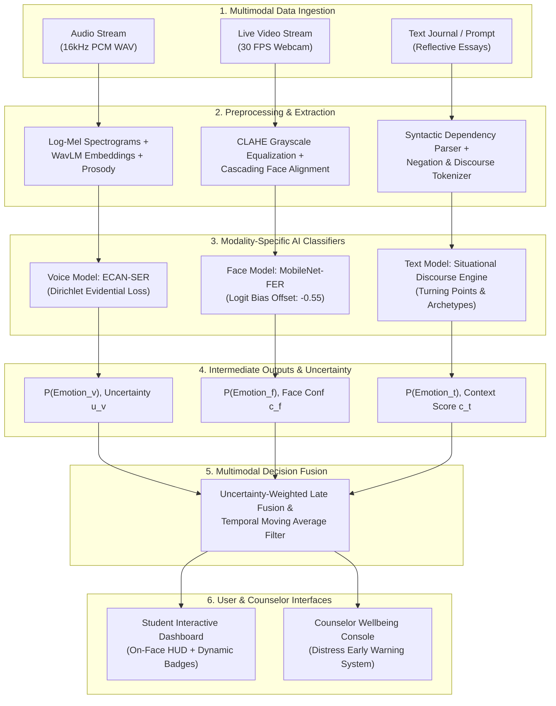

# Multimodal System Architecture & Technical Specifications

This document defines the high-level system architecture, data pipelines, model specifications, and decision fusion mechanisms of the **Multimodal AI Emotional Wellbeing Monitoring System for Students (SignalWell)**.

---

## 🏛️ System Architecture Overview

SignalWell integrates three distinct behavioral channels—**Acoustic Speech**, **Visual Facial Expressions**, and **Written Reflective Text**—into a unified student wellbeing assessment platform.

---

## 🎙️ Modality 1: Speech Emotion Recognition (Voice Pipeline)

The voice emotion module resides in `voice_model/` and is designed to recognize vocal affect from spontaneous speech without relying on explicit verbal content.

* **Architecture**: **ECAN-SER** (Efficient Channel Attention Network for Speech Emotion Recognition).
* **Backbone**: Frozen/Fine-tuned **WavLM Base+** representations concatenated with explicit prosodic acoustic features (F0 Fundamental Frequency contour, Jitter, Shimmer, Energy RMS, and 13 MFCCs).
* **Uncertainty Quantification**: Implements **Evidential Dirichlet Loss**, which models emotion class probabilities as parameters of a Dirichlet distribution $\text{Dir}(\boldsymbol{\alpha})$, allowing the network to output an explicit epistemic uncertainty estimate:
  $$u = \frac{K}{\sum_{k=1}^K \alpha_k}$$
  where $K=7$ represents the basic emotion classes.
* **Datasets**: RAVDESS, CREMA-D, TESS, SAVEE (~55k audio files), evaluated using speaker-independent cross-validation.
* **Performance**: Achieves **68.3% Macro F1** and **68.2% Accuracy** on unseen speaker benchmarks.

---

## 👁️ Modality 2: Facial Emotion Recognition & In-Situ HUD (Face Pipeline)

The facial emotion module captures visual micro-expressions, facial muscle actions (Action Units), and head pose in real-time.

### 1. Multi-Tier Cascading Face Detector
To eliminate detection dropout under variable lighting, head tilts, and webcam quality, the pipeline runs a cascading fallback:
1. **Tier 1 (High-Res Fast)**: TinyFaceDetector with input resolution $320 \times 320$, score threshold $\tau = 0.22$.
2. **Tier 2 (Low-Res Sensitive)**: TinyFaceDetector with input resolution $224 \times 224$, score threshold $\tau = 0.18$.
3. **Tier 3 (Dense Deep Detector)**: SSD MobileNet V1, score threshold $\tau = 0.20$.
4. **Tier 4 (Hardware Native)**: Browser native `window.FaceDetector` API (if supported).

### 2. Micro-Expression Preprocessing (CLAHE)
Face crops are converted to luminance channels ($Y$ or Grayscale) and preprocessed with **Contrast Limited Adaptive Histogram Equalization (CLAHE)** with clip limit 2.0 and tile grid size $8 \times 8$. This reveals subtle skin furrowing around the brow and mouth even in poorly lit dorm rooms.

### 3. Logit Bias Calibration
To counteract dataset neutral-class saturation, raw classifier logits $z \in \mathbb{R}^7$ undergo inference-time bias compensation before softmax:
$$\tilde{z}_k = \begin{cases} z_k - \Delta z_{neutral} & \text{if } k = \text{neutral} \\ z_k & \text{otherwise} \end{cases}$$
where $\Delta z_{neutral} = 0.55$. The calibrated probabilities are:
$$P(\text{emotion}_k \mid \mathbf{x}) = \frac{\exp(\tilde{z}_k / T)}{\sum_{j=1}^7 \exp(\tilde{z}_j / T)}$$
with temperature scaling $T = 1.05$.

### 4. Real-Time On-Face HUD Canvas
Unlike traditional dashboards that show predictions off to the side, the face pipeline renders a transparent HUD directly atop the user's face:
* **Targeting Reticle**: Highlighting the detected facial bounding box with neon corner brackets.
* **68 Landmark Mesh**: Subtle neon dots tracking eyebrows, pupils, nose bridge, and mouth contours.
* **Floating Header Badge**: Frosted-glass pill hovering 24px above the forehead showing the primary emotion icon, label, and confidence (e.g., `😊 HAPPINESS (87%)`).
* **Sub-Bar Indicator**: Floating beneath the chin displaying the top-3 class distribution bars.

---

## ✍️ Modality 3: Context-Aware Situational Discourse Engine (Text Pipeline)

Student journal entries often describe complex, emotionally ambiguous situations with turning points, negations, and multiple participants. The text engine in `SignalWell/` evaluates the full discourse context.

### 1. Tokenization & Discourse Boundary Parsing
Entries are segmented into discourse units based on conjunctions and punctuation:
* **Premise Clauses**: Background details and preceding events (*"I spent the whole week worrying..."*).
* **Turning-Point Markers**: Contrastive pivots (*"but"*, *"however"*, *"yet"*, *"although"*, *"in the end"*, *"finally"*).
* **Resolution Clauses**: The terminal emotional outcome (*"...it all worked out and I felt great"*).

### 2. Recency & Turning-Point Multipliers
Human emotion at the end of a situation is primarily governed by the resolution:
* Terminal resolution clauses receive a **$2.5\times$ weighting multiplier**.
* Premise clauses receive a base $1.0\times$ weight.

### 3. Negation Scope Windowing
When a negation operator ($\neg \in \{\text{"not"}, \text{"never"}, \text{"barely"}, \text{"no"}, \text{"cannot"}\}$) occurs, a 3-token forward attention window is initiated:
* If a positive sentiment token occurs inside the negation window, its positive valence is suppressed and flipped to negative valence (e.g., *"not happy"* $\rightarrow$ -0.8 Sadness/Discontent).
* If a negative token occurs inside the negation window, it is shifted to mild relief/calm (e.g., *"not anxious anymore"* $\rightarrow$ +0.7 Calm/Relief).

### 4. Self vs. Third-Party Attribution Filter
Emotions felt by third parties are distinguished from the student's own internal state:
* Sentences containing `"my friend"`, `"the teacher"`, or `"she was crying"` are parsed for the subject actor.
* If the student's reaction is supportive (*"I helped them"*, *"I stayed calm"*), the external distress is dampened by $70\%$ in the student's personal wellbeing calculation.

### 5. Situational Archetype Matchers
The engine features dedicated heuristic classifiers for core student wellbeing archetypes:
* **Relief**: High past anxiety + positive resolution.
* **Academic Burnout**: Heavy cognitive load, fatigue, feeling overwhelmed, sleep deprivation.
* **Impostor Syndrome**: External success + internal feelings of inadequacy or fraudulence.
* **Bittersweet**: Concurrent celebration and sadness (e.g., graduation, project finish).
* **Sarcastic Frustration**: Overly positive markers paired with clear failure conditions.

---

## ⚖️ Modality 4: Multimodal Decision Fusion (Late Fusion Engine)

To aggregate predictions from all three channels into a robust student assessment, SignalWell implements an **Uncertainty-Weighted Late Fusion Framework**:

### 1. Modality Confidence Weights
Each modality outputs an emotion probability vector $\mathbf{P}_m \in [0, 1]^7$ and an associated reliability weight $w_m$:
* **Voice Reliability $w_v$**: Inversely proportional to evidential Dirichlet uncertainty $u_v$:
  $$w_v = 1.0 - \min(1.0, u_v)$$
* **Face Reliability $w_f$**: Function of detector confidence, facial landmark stability, and face size relative to frame:
  $$w_f = c_{\text{detector}} \cdot \min\left(1.0, \frac{\text{Area}_{\text{face}}}{160 \times 160}\right)$$
* **Text Reliability $w_t$**: Function of text entry length and syntactic coherence:
  $$w_t = \min\left(1.0, \frac{\text{WordCount}}{25}\right) \cdot c_{\text{discourse}}$$

### 2. Consensus Aggregation Formula
The fused emotion distribution $\mathbf{P}_{\text{fused}}$ is computed as:
$$\mathbf{P}_{\text{fused}} = \frac{\sum_{m \in \{v, f, t\}} \mathbb{I}_m \cdot w_m \cdot \mathbf{P}_m}{\sum_{m \in \{v, f, t\}} \mathbb{I}_m \cdot w_m}$$
where $\mathbb{I}_m \in \{0, 1\}$ indicates whether modality $m$ is currently active.

### 3. Temporal Smoothing (Exponential Moving Average)
To eliminate frame-to-frame visual jitter or voice pitch spikes during speech pauses:
$$\mathbf{S}_t = \beta \mathbf{S}_{t-1} + (1 - \beta) \mathbf{P}_{\text{fused}, t}$$
where $\beta = 0.75$.

### 4. Counselor Early Warning Metric
A composite **Student Distress Index (SDI)** is computed continuously:
$$\text{SDI} = P(\text{Sadness}) \cdot 1.0 + P(\text{Fear/Anxiety}) \cdot 1.2 + P(\text{Anger}) \cdot 0.8 - P(\text{Happiness}) \cdot 0.6$$
* If $\text{SDI} > 0.65$ persistently for $> 3$ minutes, a yellow warning is flagged.
* If $\text{SDI} > 0.85$, a high-priority counselor intervention alert is dispatched.
