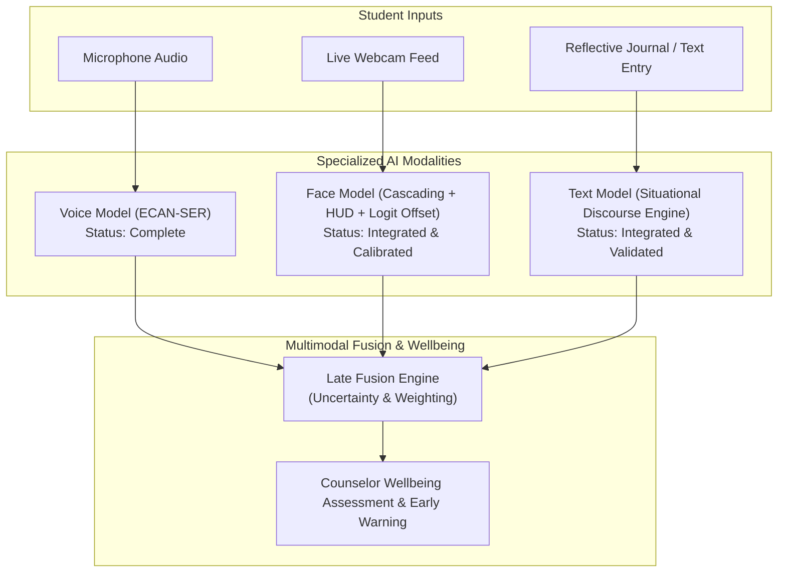

# Multimodal AI Emotional Wellbeing Monitoring System - Documentation Index

Welcome to the technical documentation repository for the **Multimodal AI-Based Emotional Wellbeing Monitoring System for Students (SignalWell)**.

This folder maintains an authoritative, end-to-end record of all architectural designs, root cause investigations, algorithm enhancements, calibration procedures, and deployment workflows implemented across the project's lifecycle.

---

## 📑 Documentation Structure

| Document | Focus & Contents |
| :--- | :--- |
| **[`01_PROCESS_LOG.md`](./01_PROCESS_LOG.md)** | **Complete Chronological Engineering Log** Details every bug encountered, diagnostic hypothesis, mathematical root cause, implemented fix, and verification results from day one through current milestones and future tasks. |
| **[`02_ARCHITECTURE.md`](./02_ARCHITECTURE.md)** | **End-to-End System Architecture** Specifications of the 4 core pillars: Speech Emotion Recognition (Voice), Facial Emotion Recognition (Face HUD), Context-Aware Situational Discourse Engine (Text), and Late Decision Fusion. |
| **[`03_FACE_DETECTION_AND_CALIBRATION.md`](./03_FACE_DETECTION_AND_CALIBRATION.md)** | **Face Emotion Pipeline & Live HUD** Root-cause analysis of webcam failures, coordinate unwarping, multi-tier cascading detector, CLAHE contrast equalization, neutral logit bias offset ($\Delta z_{neutral} = 0.55$), and on-face HUD rendering. |
| **[`04_TEXT_SITUATIONAL_PIPELINE.md`](./04_TEXT_SITUATIONAL_PIPELINE.md)** | **Context-Aware Situational Discourse Engine** Why single-word keyword models fail, Transformers.js 404 recovery, negation scope tracking, contrastive pivot weighting, third-party attribution filters, and student situational archetypes. |
| **[`05_DEPLOYMENT_AND_TESTING_GUIDE.md`](./05_DEPLOYMENT_AND_TESTING_GUIDE.md)** | **Testing, Verification & Runbook** Step-by-step instructions for running the live interactive dashboard, standalone webcam and text testers, desktop OpenCV apps, and Colab GPU scripts. |
| **[`06_FACIAL_EMOTION_AUDIT_REPORT.md`](./06_FACIAL_EMOTION_AUDIT_REPORT.md)** | **Technical Audit & Architectural Review** Comprehensive 10-point audit of InceptionResnetV1, MTCNN dropout, neutral bias saturation, preprocessing divergence, and open-source model alternatives. |
| **[`07_REALTIME_SAMPLE_EVALUATION_REPORT.md`](./07_REALTIME_SAMPLE_EVALUATION_REPORT.md)** | **Real-Time Sample Data Evaluation** Empirical evaluation across authentic user webcam test photos, Action Unit analysis, raw vs. calibrated comparisons, and confusion diagnostics. |
| **[`08_MULTIMODAL_MODEL_HUB_AND_LARGE_SCALE_TRAINING.md`](./08_MULTIMODAL_MODEL_HUB_AND_LARGE_SCALE_TRAINING.md)** | **Model Hub, Empirical Benchmarks & Large-Scale Training** Decoupled `face_model/`, `text_model/`, `models/` hubs, unified multimodal testing suite (100% pass rate), native cursor restoration, and >70,000 multi-dataset FER pipeline. |

---

## 🚀 Quick Reference: Modality Roles & Status

---

## 👥 Contributors & Responsibilities

- **Shamith ([@Shamith-247](https://github.com/Shamith-247))**:
  - Facial Emotion Recognition: Real-time webcam cascade, CLAHE contrast enhancement, logit calibration, on-face HUD badge & tracking points, Colab training pipelines.
  - Context-Aware Text Sentiment & Emotion: Situational discourse analysis, negation scope modeling, contrastive pivot evaluation, third-party attribution filtering, Colab verification.
  - Interactive Web Dashboard & Architecture Integration.
- **Siva Sethamanyu ([@SivaSethamanyu](https://github.com/SivaSethamanyu))**:
  - Speech Emotion Recognition (Voice): ECAN-SER neural architecture, WavLM feature extraction, acoustic prosody, Evidential Dirichlet Loss.

---

> **Note on Maintenance**: This `docs/` repository is continuously updated alongside code commits. All new features, architectural migrations, model retraining runs, and empirical benchmarks are appended to [`01_PROCESS_LOG.md`](./01_PROCESS_LOG.md).

